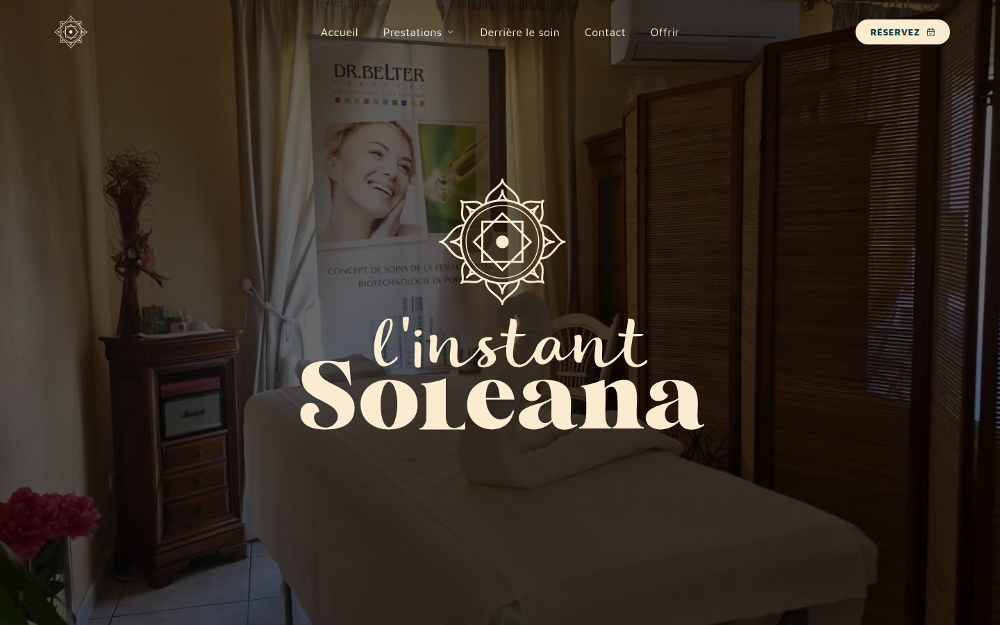
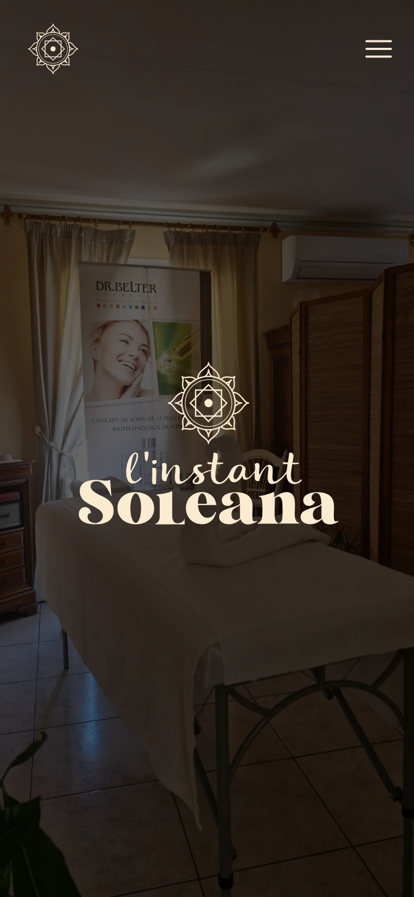

# L'Instant Soleana

Site vitrine d'une praticienne de soins bien-être à domicile, près de Perpignan.

**Site en ligne : [www.linstant-soleana.fr](https://www.linstant-soleana.fr)**



<p>
  
  
</p>

---

## Le besoin

L'Instant Soleana propose des massages, soins du visage, épilations, maquillage et soins
énergétiques, directement **au domicile de ses clientes** à Perpignan et dans les villages
alentour, ainsi que chez des partenaires.

La cliente avait besoin d'un site pour :

- **présenter ses prestations et ses tarifs** clairement ;
- **amener le visiteur à réserver** (via son agenda en ligne SumUp Bookings) ou à envoyer une
  **demande de contact**, en tant que particulier ou professionnel ;
- **être trouvée localement** sur Google (« massage à domicile Perpignan », etc.).

Les contraintes :

- une clientèle locale qui consulte **surtout depuis un téléphone** ;
- **aucun coût d'hébergement** ni serveur à maintenir ;
- des tarifs et des prestations qui changent : il faut pouvoir les modifier **sans toucher au code** ;
- une identité visuelle douce et sobre, avec une charte de quatre couleurs à respecter strictement.

## La réponse

Un site **100 % statique**, pensé d'abord pour le mobile :

- **Accueil** : présentation, actualités, accès aux prestations, contact particulier ou pro ;
- **une page par prestation**, générée automatiquement à partir d'un fichier JSON (présentation,
  grilles tarifaires, informations pratiques) ;
- une page de présentation de la praticienne, une page dédiée à un partenaire, une page contact
  avec formulaire, et les pages légales ;
- la **réservation** reste gérée par SumUp (lien externe) : le site oriente vers l'outil existant,
  sans le refaire ;
- un **formulaire de contact** sans serveur (Web3Forms) avec une page de confirmation ;
- un **référencement local** : données structurées, liste des villages desservis, sitemap.

## Choix techniques

| Choix                                          | Pourquoi                                                                                                                              |
| ---------------------------------------------- | ------------------------------------------------------------------------------------------------------------------------------------- |
| **Astro 7**, sortie statique, sans adaptateur  | Du HTML pur, rapide à charger sur mobile, et hébergeable gratuitement                                                                 |
| **Aucun JavaScript côté client par défaut**    | Seule la navigation (menu mobile, sous-menu, barre au défilement) en utilise                                                          |
| **Content collections** (JSON + schéma Zod)    | Chaque prestation est un fichier JSON validé au build : ajouter une grille de tarifs ne demande pas de toucher au code                |
| **TypeScript strict**                          | Les props et les données sont typées ; une erreur de schéma est signalée dans la page concernée                                       |
| **SCSS sans framework**                        | Toutes les couleurs et tailles de texte sont des variables CSS (tokens) : la charte est respectée partout, sans couleur écrite en dur |
| **Polices auto-hébergées** (API Fonts d'Astro) | Pas d'appel à Google Fonts : meilleur pour le RGPD et pour la vitesse                                                                 |
| **Web3Forms**                                  | Formulaire fonctionnel sans backend à maintenir                                                                                       |
| **Cloudflare Workers** (fichiers statiques)    | Hébergement gratuit, déploiement automatique à chaque push sur `master`, cache long pour les fichiers versionnés                      |

## Qualité

Scores **Lighthouse mobile** mesurés sur le site en production (octobre 2026) :

| Page                  | Performance | Accessibilité | Bonnes pratiques | SEO |
| --------------------- | :---------: | :-----------: | :--------------: | :-: |
| Accueil               |     94      |      95       |       100        | 100 |
| Prestation (massages) |     100     |      95       |       100        | 100 |
| Derrière le soin      |     100     |      95       |       100        | 100 |
| Partenaire            |     98      |      95       |       100        | 100 |
| Contact               |     100     |      96       |       100        | 100 |

Côté accessibilité : HTML sémantique, un seul `h1` par page et une hiérarchie de titres sans saut,
contrastes AA, focus visible, menu mobile utilisable au clavier (`aria-expanded`, `inert`,
fermeture avec Échap), champs de formulaire avec des libellés visibles.

Côté SEO : titre et description propres à chaque page, données structurées JSON-LD
(`HealthAndBeautyBusiness`, zone desservie), sitemap, URL avec `/` final cohérentes avec l'hébergeur.

## Ce que j'ai appris

- **Séparer les données de l'affichage.** Les pages chargent les collections et passent les données
  aux composants, qui ne savent pas d'où elles viennent. Résultat : un changement de tarif se fait
  dans un JSON.
- **Le build n'est pas le mode dev.** Un préfixe `-webkit-` écrit à la main faisait disparaître la
  propriété standard à la minification : le flou de la barre de navigation marchait en local et pas
  en production.
- **Migrer sans tout casser.** Passage de Vercel à Cloudflare Workers et montée de version vers
  Astro 7, sur une branche dédiée, avec validation de la cliente avant la mise en production.
- **Travailler pour une vraie cliente.** Ne pas inventer de contenu, faire valider les textes et
  les choix visuels, et respecter une charte même quand une couleur « de plus » serait pratique.

## Méthode

Projet réalisé seul, de l'analyse du besoin au déploiement, avec l'aide d'un assistant IA
(Claude Code). Les règles du projet (architecture, conventions CSS, accessibilité) sont écrites
en amont ; chaque proposition est relue, comprise et validée avant d'être intégrée.

## Lancer le projet

Node 22 requis.

```bash
npm install
echo "WEB3FORMS_CLE=votre_cle" > .env   # obligatoire, le build échoue sans elle
npm run dev                             # http://localhost:4321
```

| Commande          | Rôle                                 |
| ----------------- | ------------------------------------ |
| `npm run dev`     | Serveur de développement             |
| `npm run build`   | Génère le site statique dans `dist/` |
| `npm run preview` | Prévisualise le build                |
| `npx astro check` | Vérification TypeScript              |

## Structure

```text
src/
  pages/           une route = un fichier ; les données sont chargées ici
  content/         prestations et partenaires (JSON validés par content.config.js)
  data/            navigation, coordonnées, villages desservis, actualités
  components/      composants Astro, rangés par usage (global, contact, prestations, ui)
  styles/          tokens (couleurs, typographie), breakpoints et mixins SCSS
  scripts/Navbar/  seul JavaScript client du site
```

---

Conception et développement : Julien Marchand.
Contenus et photos : L'Instant Soleana, tous droits réservés, et galerie Unsplash, libre de droits.
